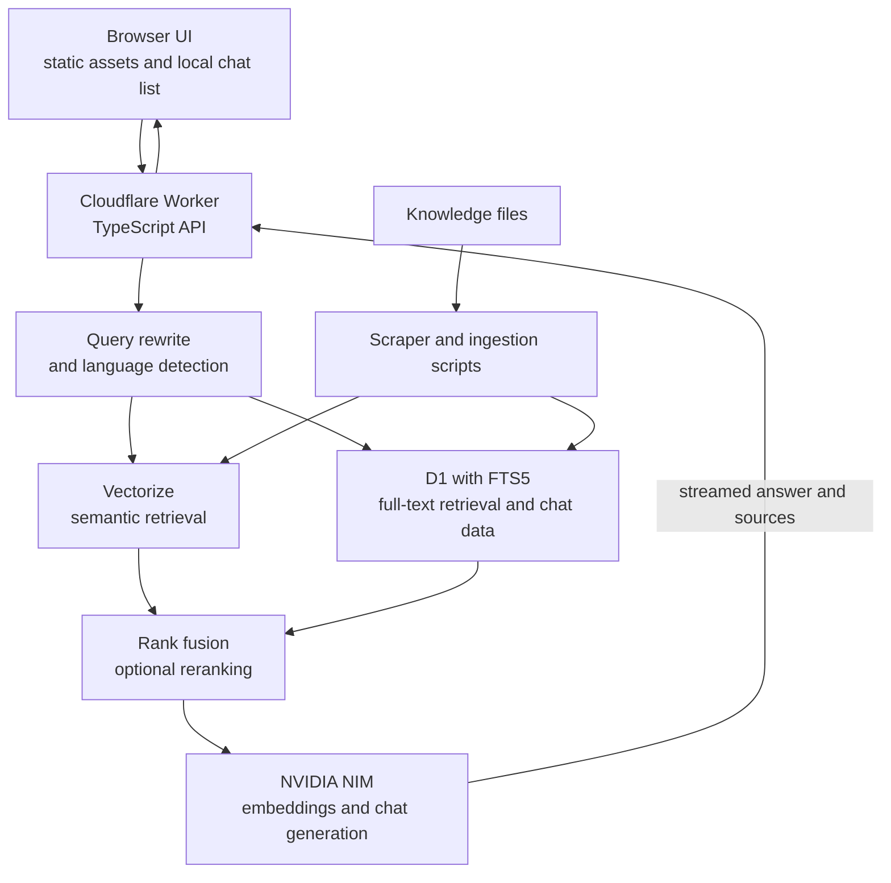

# E-JUST AI Assistant

**Live demo:** [ejustai.ziad-dev9.workers.dev](https://ejustai.ziad-dev9.workers.dev/)

E-JUST AI is a bilingual question-and-answer assistant for information about Egypt-Japan University of Science and Technology (E-JUST). It retrieves passages from a university knowledge base, generates streamed answers, and displays linked sources alongside responses. The application runs as a Cloudflare Worker with a static HTML, CSS, and JavaScript interface.

## Capabilities

- Ask questions about E-JUST programs, admissions, tuition, scholarships, research, and campus life in English or Arabic.
- Retrieve relevant passages using semantic search in Cloudflare Vectorize and full-text search in Cloudflare D1. When both are available, results are combined with reciprocal rank fusion and can be reranked through NVIDIA NIM.
- Stream generated answers to the browser and show inline citation markers with expandable links to source pages.
- Keep recent chat sessions in browser storage, restore a session, and start a new chat. The interface also supports personalized names, generated chat titles, copy actions, and helpfulness feedback.
- Ingest crawled university web pages and extracted PDF text into knowledge chunks for search. A bundled chunk set provides a limited retrieval fallback.

The chat API detects English or Arabic input, resolves follow-up questions using recent conversation context, and formats responses for the detected language. Arabic messages receive right-to-left presentation in the interface.

## Architecture



When both search indexes return results, retrieval uses reciprocal rank fusion and optionally reranks the fused candidates. If one index is unavailable, the Worker can use the other search path; bundled chunks provide a keyword fallback. The Worker also exposes health, chat, history, feedback, profile, title, and clear-history routes.

## Technology

- **Runtime and hosting:** Cloudflare Workers, Workers Static Assets, Wrangler
- **Knowledge and chat storage:** Cloudflare Vectorize and D1 (SQLite with FTS5); browser `localStorage` for saved chat sessions
- **Inference:** NVIDIA NIM chat, embedding, and optional reranking APIs
- **Application:** TypeScript Worker, static HTML/CSS/JavaScript interface
- **Ingestion:** Python 3.11, BeautifulSoup, and PyMuPDF; TypeScript scripts run with `tsx`
- **Development checks:** TypeScript, Vitest

## Local setup

### Requirements

- Node.js 22 or newer and npm
- A Cloudflare account for the configured D1 and Vectorize resources
- An NVIDIA API key for live embeddings and answer generation
- Python 3.11 only if running the crawler

### Run the Worker locally

```bash
npm ci
```

Create a `.dev.vars` file in the repository root and set your NVIDIA key:

```dotenv
NVIDIA_API_KEY=your_nvidia_api_key
```

Then start Wrangler:

```bash
npm run dev
```

The Wrangler configuration marks D1 and Vectorize as remote resources for local development. Wrangler authentication and access to the configured Cloudflare resources are therefore needed for those search paths. Keep `.dev.vars` and other credentials out of version control.

## Deployment

The included GitHub Actions workflow deploys on pushes to `main` and can also be started manually. It installs dependencies, runs type checking and the Vitest suite, applies D1 migrations, and deploys the Worker. Configure `CLOUDFLARE_API_TOKEN` and `CLOUDFLARE_ACCOUNT_ID` as GitHub Actions secrets, and configure `NVIDIA_API_KEY` as a Worker secret:

```bash
npx wrangler secret put NVIDIA_API_KEY
npx wrangler d1 migrations apply ejustai-db --remote
npm run deploy
```

The Worker and static assets are deployed together. The production D1 and Vectorize bindings, model settings, and retrieval limits are declared in [`wrangler.jsonc`](wrangler.jsonc).

## Useful commands

| Command | Description |
| --- | --- |
| `npm run dev` | Start the local Wrangler development server. |
| `npm run typecheck` | Run TypeScript type checking without emitting files. |
| `npm test` | Run the Vitest test suite. |
| `npm run deploy` | Deploy the Worker and static assets with Wrangler. |
| `npm run ingest` | Build knowledge chunks and D1 seed SQL from files in `knowledge/`; create embeddings when an NVIDIA key is configured. |
| `npm run ingest:remote` | Build embeddings and upload the knowledge index to the configured remote D1 and Vectorize resources. |
| `pip install -r scripts/requirements.txt` | Install Python crawler dependencies. |
| `python scripts/scrape_ejust.py --max-pages 600` | Crawl up to the selected number of university pages and extract content for ingestion. |

The ingestion scripts write generated index artifacts. The remote ingestion command updates the configured remote knowledge index, so use it when intentionally refreshing that data.

## Project structure

```text
public/index.html                 Browser interface and client-side chat behavior
src/index.ts                      Worker routes and request orchestration
src/rag.ts                        Chunking, retrieval, fusion, citations, prompts
src/nvidia.ts                     NVIDIA NIM embeddings, rewriting, reranking, generation
src/storage.ts                    D1, KV, and in-memory chat/feedback storage paths
src/data/kb-chunks.json           Bundled retrieval fallback data
knowledge/                        Source documents used by ingestion
scripts/scrape_ejust.py           University page and PDF crawler
scripts/ingest.ts                 Chunk, embed, and index ingestion workflow
migrations/                       D1 schema migrations
tests/                            Vitest tests
.github/workflows/                Deployment and scheduled data-ingestion workflows
```

## License and notices

This repository does not currently include a `LICENSE` file. No license is stated for reuse. Third-party libraries are declared in [`package.json`](package.json), [`package-lock.json`](package-lock.json), and [`scripts/requirements.txt`](scripts/requirements.txt); consult their respective licenses when using or redistributing them.
